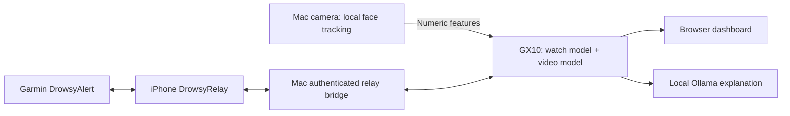

# DrozyAI

A hackathon prototype that combines Garmin watch sensors and live camera features into a continuously displayed drowsiness score. Model inference and an optional local AI explanation run on the GX10. The Mac provides the camera and network bridge; the iPhone relays watch telemetry and returned predictions.

## Architecture



Video frames stay in the browser. Numeric face features travel to the GX10. The watch model uses heart rate, genuine beat intervals, motion variance and temperature trend. Blood oxygen and watch temperature are also displayed when available.

## Current behavior

- Saved gradient boosting watch model and small video TCN; logistic regression is available as a recorded-feature benchmark.
- Fresh, aligned watch and video scores are averaged 50/50. A single eligible model supplies the result when the other is unavailable.
- The first 15 seconds of camera observations are assumed neutral. The video score is the raw TCN output attenuated by sustained changes from that baseline. Normal blinking and small movements are tolerated. The dashboard exposes the raw output and adjustment, and has a **Reset 15-second baseline** control.
- Motion variance carries across gaps up to five seconds; HR carries up to three seconds. Temperature retains the last real reading when later values are null. Genuine IBI is required and is never derived from HR.
- Partial video results are labelled provisional and excluded from the main score and alerts. They remain visible while a full usable window collects.
- The dashboard and watch retain the last valid score between updates, with its age. Predictions update at five-second window boundaries.
- Warning advice requires three consecutive scores at or above 70/100; 90/100 triggers the high action immediately.
- Optional Ollama `llama3.2:3b` provides an explanation. Deterministic rules select the action and score; they remain available if the LLM fails.

The scores are experimental research indicators, not calibrated probabilities. The baseline adjustment is a demo heuristic, not evidence of improved detection accuracy. Garmin/webcam transfer has not been clinically validated.

## Run the GX10 demo

You need Python 3.12, Node.js, a Mac with a camera, and the paired Garmin/iPhone apps. The GX10 deployment was tested on aarch64 Linux. Use the repository branch containing this README.

### 1. GX10

From this project folder:

```sh
python3 -m venv .venv-gx10
.venv-gx10/bin/python -m pip install -r deployment/requirements-gx10.lock.txt
# Optional explanations, with Ollama installed and running:
ollama pull llama3.2:3b
# Use the Mac's Wi-Fi IP so the iPhone can reach the relay bridge:
export DROWSY_PHONE_URL=http://YOUR_MAC_LAN_IP:8767
./deployment/start.sh
```

Keep the server running. Model inference also works when the local LLM is unavailable; explanations fall back to deterministic text. The server creates a fresh phone pairing token at launch. Neither the token nor passwords belong in this repository.

### 2. Mac

From a checkout of this project, open a separate terminal:

```sh
./deployment/connect_mac.sh YOUR_GX10_USER@YOUR_GX10_IP
```

Keep the connection open and visit **http://127.0.0.1:8779/**. Select **MacBook Air Camera** and press **Start camera**. Look ahead normally for the first 15 seconds.

### 3. iPhone and watch

Open DrowsyAlert on the watch and DrowsyRelay on its paired iPhone. In the dashboard, select **Show phone pairing details**. Enter that phone URL and token into **Connect laptop** on the iPhone, then select the watch. Keep both apps open. See [iPhone setup](phone-companion/README.md) and [Garmin app](DrowsyApp/DrowsyAlert/PHONE_BLUETOOTH.md) for build/install details. Choose your own Apple signing team in Xcode and keep the Garmin developer signing key local.

Allow about 60 seconds for a watch window. Camera baseline collection plus a full model window normally takes about 75 seconds. Tracking or sensor gaps may extend this. The Mac's LAN IP can change between networks; update `DROWSY_PHONE_URL` and the phone connection when it does.

## Project layout

| Folder | Purpose |
|---|---|
| `src/models/` | Saved-model loading and inference |
| `src/features/` | Watch, facial-event and fusion feature logic |
| `src/advisor/` | Deterministic advice and optional local LLM explanations |
| `web/` | Dashboard, camera feature extraction and connected model service |
| `realtime_backend/` | Streaming contracts, alignment and runtime support |
| `phone-companion/` | Native iPhone relay, local relay server and transport tests |
| `DrowsyApp/DrowsyAlert/` | Connect IQ watch app source and resources |
| `data/processed/` | Four small fitted runtime model artifacts and existing training references |
| `deployment/` | GX10 dependency versions and launch/bridge scripts |
| `tests/` | Model integration, sensor processing and browser logic checks |

## Validation

The deployed baseline release passed **69 Python checks**, **25 browser-logic checks**, and an isolated HTTP relay round trip using the actual saved models with synthetic inputs. The watch simulator passed **10 tests**. Real watch and camera inputs also produced synchronized 50/50 results on the GX10. These checks establish integration behavior, not real-world drowsiness detection accuracy.

```sh
.venv-gx10/bin/python -B -m unittest discover -s tests -q
node --test tests/advisor-view.test.mjs tests/metrics.test.mjs tests/model-features.test.mjs tests/score-display.test.mjs tests/dashboard-readings.test.mjs
.venv-gx10/bin/python -B tests/relay_roundtrip.py
```

The isolated relay test does not connect to a physical watch. Model artifacts retain their original weights; nine cross-platform predictions matched the Mac to within `2.99e-8` before live sensitivity adjustment.

Original training notes are preserved in [docs/TRAINING_NOTES.md](docs/TRAINING_NOTES.md). See [connection details](CONNECTION_GUIDE.md) and [transport contract](phone-companion/RELAY_CONTRACT.md) for deeper integration information.

## Local files

Keep raw recordings, live sensor logs, pairing tokens, `.env` files, signing keys, Xcode user settings and virtual environments out of Git. The ignore rules cover these local outputs. The four fitted runtime model files are intentionally included so the inference demo can load immediately.


## Data source

This project uses the UL-DD dataset:

Bodaghi, M., Hosseini, M., Gottumukkala, R., Bhupatiraju, R. T., Ahmad, I., & Gabbouj, M. (2025). *UL-DD: A multimodal drowsiness dataset using video, biometric, and behavioral data* (Version v1) [Data set]. Zenodo. https://doi.org/10.5281/zenodo.17978727
